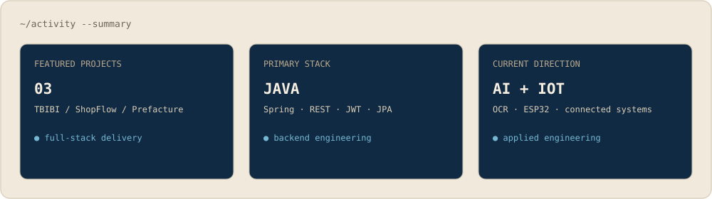
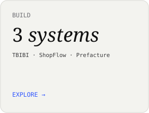
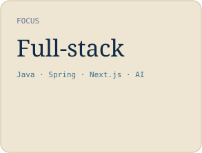
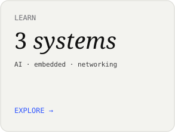
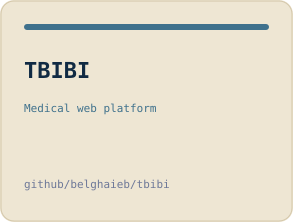
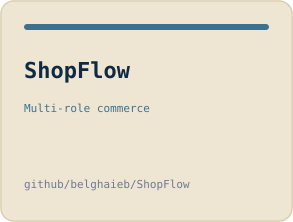
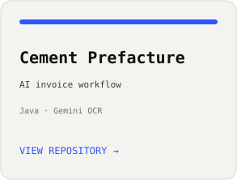

 
 
 
 
 

<a href="https://azizbelghaieb.netlify.app">portfolio</a> &nbsp;/&nbsp;
<a href="https://linkedin.com/in/aziz-belghaieb-749044382">linkedin</a> &nbsp;/&nbsp;
<a href="mailto:azizbelghaieb@proton.me">email</a>

