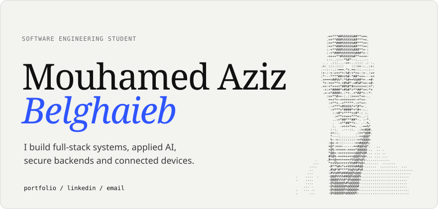
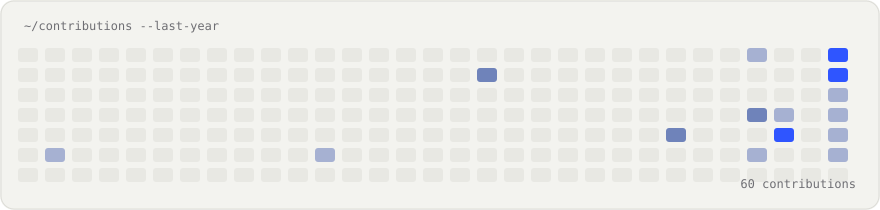
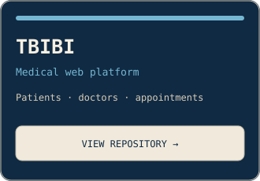
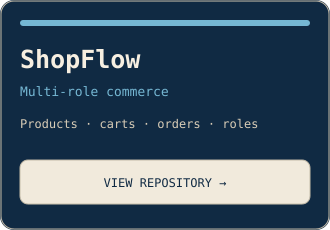
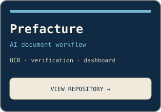

 
 
 

<a href="https://azizbelghaieb.netlify.app">portfolio</a> &nbsp;/&nbsp;
<a href="https://linkedin.com/in/aziz-belghaieb-749044382">linkedin</a> &nbsp;/&nbsp;
<a href="mailto:azizbelghaieb@proton.me">email</a>

 

## `~ $ ./stack --compact`

| DOMAIN | TECHNOLOGIES |
|---|---|
| **Languages** | Java · C++ · C# · C · Python · TypeScript · JavaScript · Prolog |
| **Backend** | Spring Boot · JPA/Hibernate · REST · JWT · WebSockets |
| **Frontend** | Next.js · React · Angular · HTML/CSS · Thymeleaf |
| **Data & AI** | PostgreSQL · NLP · TF-IDF · OCR · ETL / OLAP |
| **Systems** | Linux · Arduino · ESP32-S3 · Cisco networking |

 

## `~ $ cat credentials.txt`

- **LPI Linux Essentials**
- **Linux Unhatched — Cisco Networking Academy**, November 2024

 

## `~ $ git status`

 

<picture>
  <source media="(prefers-color-scheme: dark)" srcset="https://raw.githubusercontent.com/belghaieb/belghaieb/output/github-snake-dark.svg">
  <source media="(prefers-color-scheme: light)" srcset="https://raw.githubusercontent.com/belghaieb/belghaieb/output/github-snake.svg">
  
</picture>

