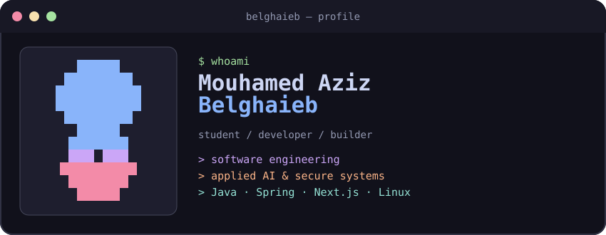
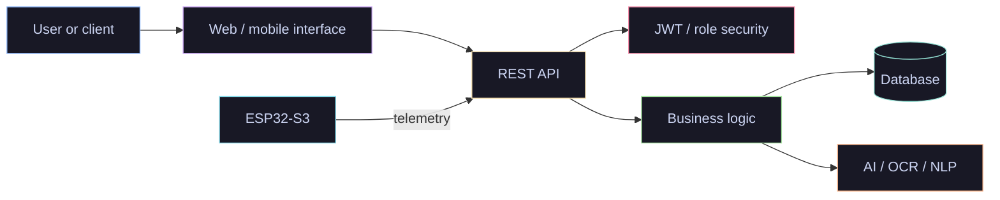
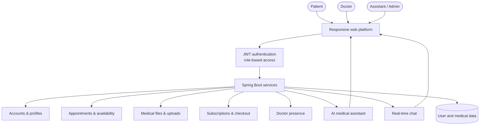
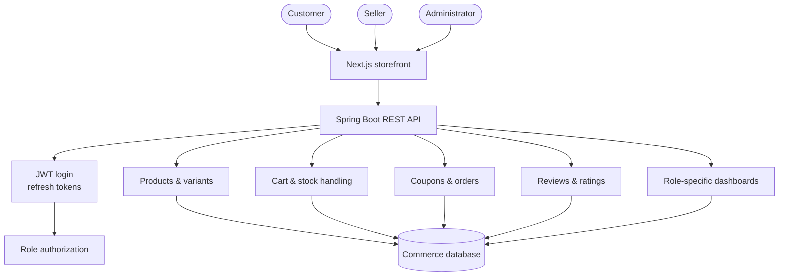
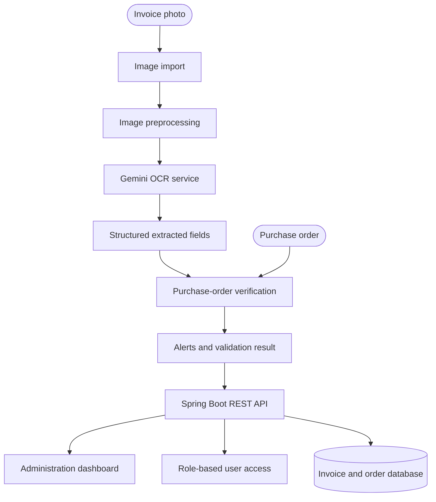

<div align="center">



<a href="https://azizbelghaieb.netlify.app/"></a>
<a href="https://linkedin.com/in/aziz-belghaieb-749044382"></a>
<a href="mailto:azizbelghaieb@proton.me"></a>

</div>

<br/>

## `~ $ cat identity.txt`

```text
Mouhamed Aziz Belghaieb
role       software engineering student + full-stack developer
location   Tunisia
focus      secure systems · applied AI · embedded & connected products
mode       turning complex requirements into working software
```

Third-year software engineering student at the University of Monastir. I combine strong fundamentals in algorithms, networks and object-oriented design with end-to-end implementation across backend, frontend, AI and embedded systems.

<br/>

## `~ $ ./showcase --mode=architecture`



<br/>

## `~ $ ls -l ./featured-projects`

> Three systems, three kinds of complexity: **people and healthcare**, **commerce and roles**, and **documents and AI verification**.

---

### `01/ TBIBI`

**A complete medical web platform for patients, doctors and administrative staff**

TBIBI organizes the journey between a patient and a doctor. It combines account management, appointment availability, medical documents, subscriptions, live presence and an AI assistant in one application.



| What is implemented | Technical proof |
|---|---|
| Authentication and role separation | JWT filter, login/register flows and protected controllers |
| Appointment workflows | Availability, booking, status and appointment services |
| Medical document handling | Secure upload endpoints and file-category entities |
| AI-assisted support | Spring AI chat client and assistant controller |
| Live communication | WebSocket configuration and chat message entities |
| Account recovery | Password-reset tokens and email service |
| Production-oriented structure | DTOs, entities, repositories, services and exception handling |

`Java` `Spring Boot` `Spring Security` `JWT` `Spring AI` `WebSocket` `REST` `JavaScript` `HTML` `CSS`

<a href="https://github.com/belghaieb/tbibi">**→ Explore the TBIBI repository**</a>

---

### `02/ ShopFlow`

**A full-stack multi-role commerce system built around real business operations**

ShopFlow is more than a storefront: the same platform serves customers, sellers and administrators. Each role receives dedicated workflows, while the backend protects operations with authentication and role-aware services.



| What is implemented | Technical proof |
|---|---|
| Customer experience | Product browsing, details, cart, checkout and account pages |
| Seller operations | Seller dashboard and product/order-oriented flows |
| Administration | Dedicated admin dashboard and user administration |
| Secure sessions | JWT authentication, refresh-token entity and authorization filter |
| Commerce rules | Stock checks, order status changes, coupons and cart services |
| Trust and feedback | Review entities, service methods and rating UI |
| Testing | Service tests for cart, order, product and review behavior |

`Next.js` `TypeScript` `Tailwind CSS` `Java` `Spring Boot` `JWT` `PostgreSQL` `Python` `REST`

<a href="https://github.com/belghaieb/ShopFlow">**→ Explore the ShopFlow repository**</a>

---

### `03/ Cement Prefacture`

**An intelligent invoice workflow that turns a photo into verified business data**

This project addresses a concrete industrial process: importing invoice photos, extracting fields with AI, comparing them with purchase orders and presenting the result to operational users.



| What is implemented | Technical proof |
|---|---|
| Document import | Invoice/photo endpoints and import service |
| AI extraction | Gemini OCR service and extracted-field DTO |
| Business verification | Purchase-order comparison and validation-result service |
| Validation controls | Invoice status, custom exceptions and global error handling |
| Operational interface | Dashboard, invoice, factures and administrator screens |
| User management | Authentication, role entities and protected API configuration |
| API documentation | Springdoc/OpenAPI setup |

`Java` `Spring Boot` `Gemini AI` `OCR` `Spring Security` `REST` `JavaScript` `HTML` `CSS`

<a href="https://github.com/belghaieb/cement-project">**→ Explore the Cement Prefacture repository**</a>

<br/>

## `~ $ ./stack --compact`

| DOMAIN | TECHNOLOGIES |
|---|---|
| **Languages** | Java · C++ · C# · C · Python · TypeScript · JavaScript · Prolog |
| **Backend** | Spring Boot · JPA/Hibernate · REST · JWT · WebSockets |
| **Frontend** | Next.js · React · Angular · HTML/CSS · Thymeleaf |
| **Data & AI** | PostgreSQL · NLP · TF-IDF · OCR · ETL / OLAP |
| **Systems** | Linux · Arduino · ESP32-S3 · Cisco networking |

<br/>

## `~ $ cat credentials.txt`

- **LPI Linux Essentials**
- **Linux Unhatched — Cisco Networking Academy**, November 2024

<br/>

## `~ $ git status`

<div align="center">


<br/>


<picture>
  <source media="(prefers-color-scheme: dark)" srcset="https://raw.githubusercontent.com/belghaieb/belghaieb/output/github-snake-dark.svg">
  <source media="(prefers-color-scheme: light)" srcset="https://raw.githubusercontent.com/belghaieb/belghaieb/output/github-snake.svg">
  
</picture>

</div>
